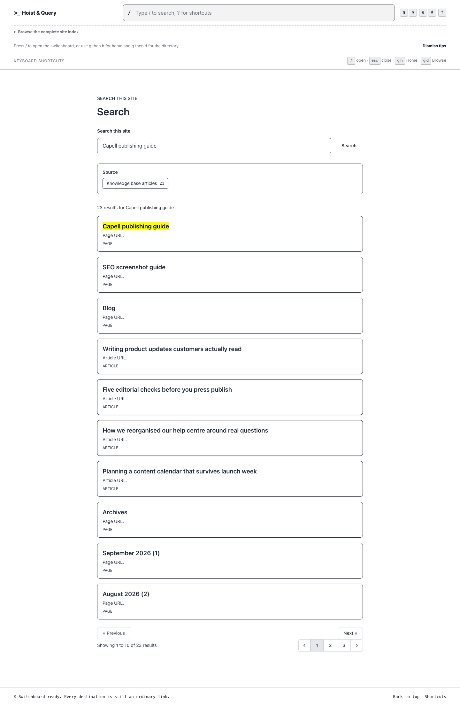
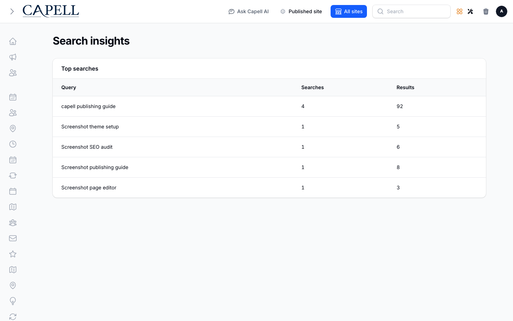

# Search

<!-- prettier-ignore-start -->

## What It Does

Search adds public search, autocomplete, facets, synonyms, promoted results, spelling correction, and search analytics that honour browser privacy signals.

- **Price and availability:** Check current availability and price on the [Capell Marketplace listing](https://capell.app/extensions/search).
- **Licence:** Check the licence terms on the [Capell Marketplace listing](https://capell.app/extensions/search).
- **Requires:** `PHP ^8.4`, `capell-app/admin ^1.0.66`, `capell-app/core ^1.0.76`, `capell-app/discovery-foundation ^1.0`, `capell-app/frontend ^1.0.72`, `lorisleiva/laravel-actions ^2.8`, `spatie/laravel-data ^4.5`, `spatie/laravel-package-tools ^1.14.1`.
- **Install:** `composer require capell-app/search`.

Visitors can search indexed site content from the public search surface. Admins configure search behaviour and inspect top, trending, clicked, and zero-result queries.

## Who It Is For

**For developers:** The searchable-source registry and Search contract keep indexing backends replaceable while Actions normalise, sanitize, enhance, and record queries.

**For teams:** Teams can help visitors find content and use failed or repeated searches to decide which synonyms, promoted results, or content gaps to address.

## Quick Start

1. Install the package: `composer require capell-app/search`.
2. Open the package admin surface at `/admin/extensions` and confirm Search is available.

## Configure

- **Configuration files:** `config/capell-search.php`.
- **Admin settings:** `Capell\Search\Settings\SearchSettings`.
- **Commands:** `php artisan capell:search:screenshot-fixture`, `php artisan search:flush`, `php artisan search:index`, `php artisan search:purge`.

## Limits And Pitfalls

- Install the required Capell packages at the versions in `composer.json`: `capell-app/admin ^1.0.66`, `capell-app/core ^1.0.76`, `capell-app/discovery-foundation ^1.0`, `capell-app/frontend ^1.0.72`.
- Run migrations before opening package resources or public routes.
- Review middleware, throttling, signatures, and public-output safety in `routes/web.php` before exposing routes.
- Keep the host Laravel scheduler running so package-registered schedules can execute: `search:purge (monthly; package registered)`.
- Keep public Blade and cached HTML free of authoring markers, model IDs, permissions, signed editor URLs, and lazy database queries.
- Custom write integrations must preserve invalidation for `search` cache tags.

## Screens And Workflow

- Frontend search results page (frontend).
- Header search field (frontend).
- Top searches widget (admin).
- Trending searches widget (admin).
- Zero-result searches widget (admin).
- Site search settings screen (admin).
- Native Search curation settings (admin).

## Install Impact

- Required packages: `capell-app/admin`, `capell-app/core`, `capell-app/discovery-foundation`, `capell-app/frontend`.
- Admin navigation: declares `admin-page: SearchSettingsPageContribution`; each Filament page or resource controls its own navigation visibility.
- Admin/editor extensions: `dashboard-widget: TopSearchesWidgetContribution`, `dashboard-widget: TrendingSearchesWidgetContribution`, `dashboard-widget: ZeroResultSearchesWidgetContribution`, `overview-stat: SearchOverviewStatsContribution`.
- Permissions: Shield-generated page permissions for `Capell\Search\Filament\Pages\SearchSettingsPage` (names and grants depend on host Shield configuration).
- Public routes: loads `routes/web.php`; registers `SearchFrontendRouteContribution`.
- Database changes: package migrations are declared.
- Config: `config/capell-search.php`.
- Settings: `Capell\Search\Settings\SearchSettings`.
- Queues or schedules: scheduled commands `search:purge (monthly; package registered)`.
- Cache tags: `search`.
- Commands: `capell:search:screenshot-fixture`, `search:flush`, `search:index`, `search:purge`.

## Troubleshooting

| Symptom | Likely cause | Check | Fix |
| --- | --- | --- | --- |
| Package surface is missing after install | Provider or manifest is not loaded | Confirm `capell.json`, package `composer.json`, and provider registration | Reinstall the package, refresh Composer autoload, and clear host caches |
| Admin screen or command fails on missing table | Package migrations have not run | Check the tables listed in `Data Model` | Run host migrations and rerun the focused package test |
| Route returns unexpected output | Route cache, middleware, or signed URL setup does not match the package route file | Check the route files listed in `Technical Shape` | Clear route cache and verify middleware before exposing public routes |
| Background work does not run | Queue worker or declared schedule is not active | Check the jobs and scheduled commands listed in `Technical Shape` | Start the queue worker or host scheduler, then run the focused command or package test |
| Public output leaks unexpected state | Render data, cache variation, or authoring boundary has regressed | Check public Blade, cache tags, and public-output safety tests | Move data loading out of Blade and rerun the package public-output tests |

## Upgrading

No manual steps between minor versions.

Read [CHANGELOG.md](CHANGELOG.md) before upgrading.

## Next Steps

- [Package docs](docs/README.md)
- [Overview](docs/overview.md)
- [Worked extension examples](docs/extension-contracts.md)
- [Admin guide](docs/admin-guide.md)
- Configuration files: [`config/capell-search.php`](config/capell-search.php).
- [Troubleshooting](#troubleshooting)
- [Developer reference](docs/reference.md)
- [Marketplace assets](docs/assets/marketplace/)
- [Capell content language plan](../../docs/CONTENT_LANGUAGE_PLAN.md)
- [Capell documentation design system](../../docs/DESIGN_SYSTEM.md)
- [Capell and package ERD notes](../../docs/erd/capell-and-package-erds.md)
- Related packages: [Discovery Core](../discovery-foundation/README.md), [SEO Suite](../seo-suite/README.md), [Site Discovery](../site-discovery/README.md), [URL Manager](../url-manager/README.md).

<!-- prettier-ignore-end -->
